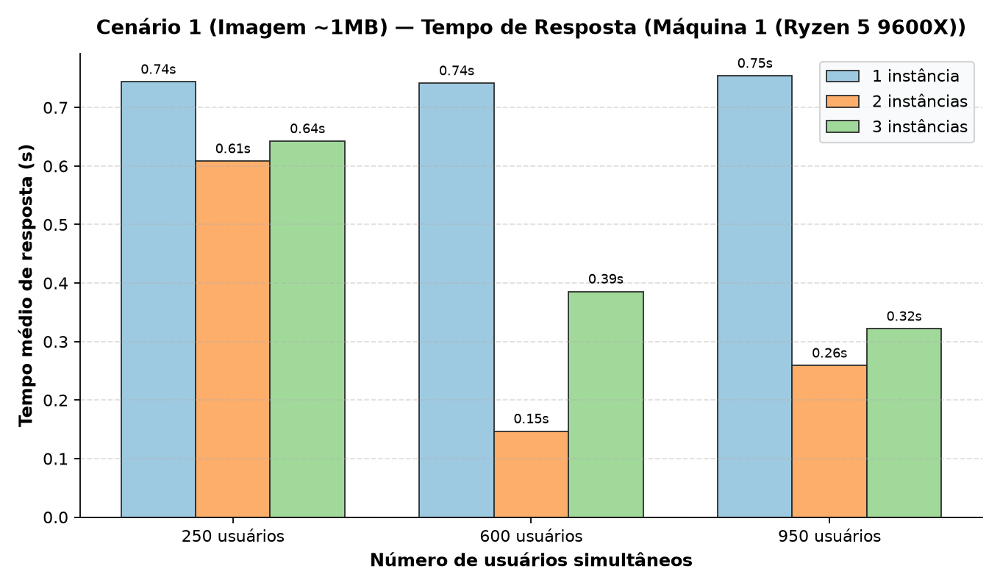
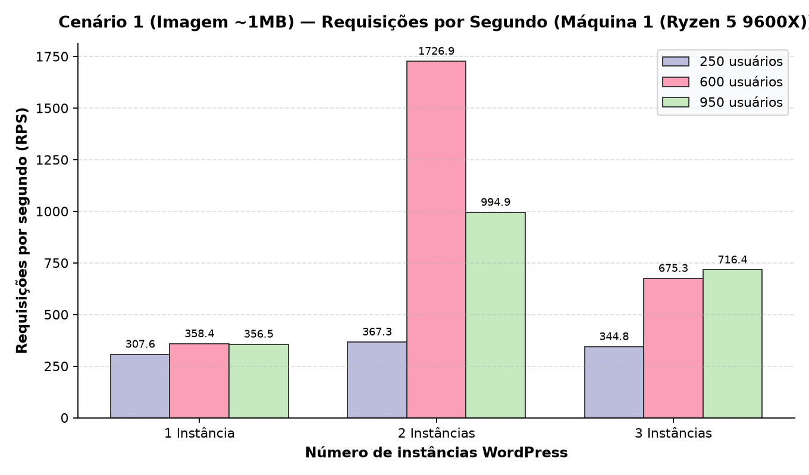
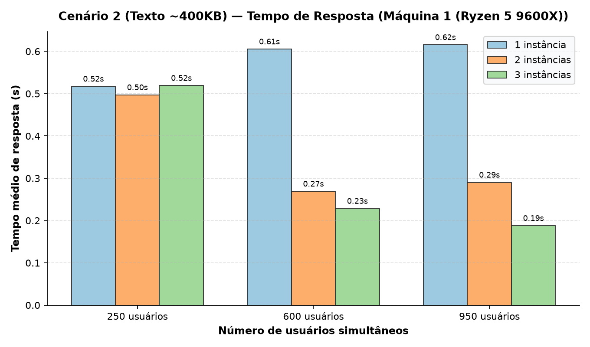
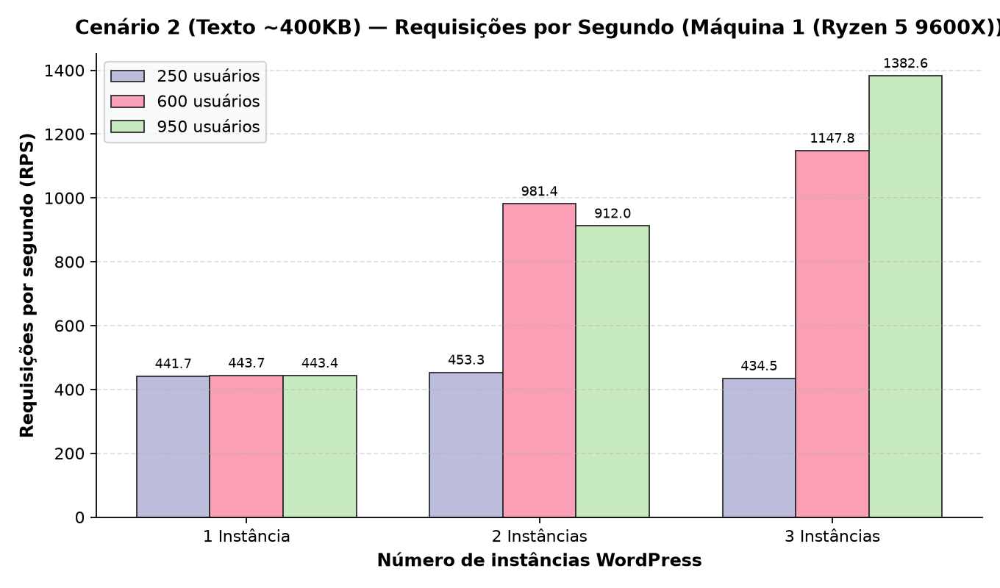
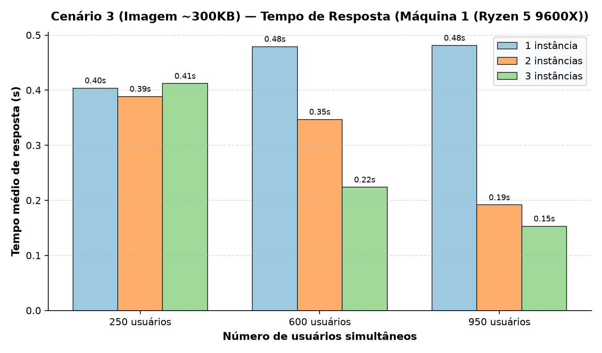
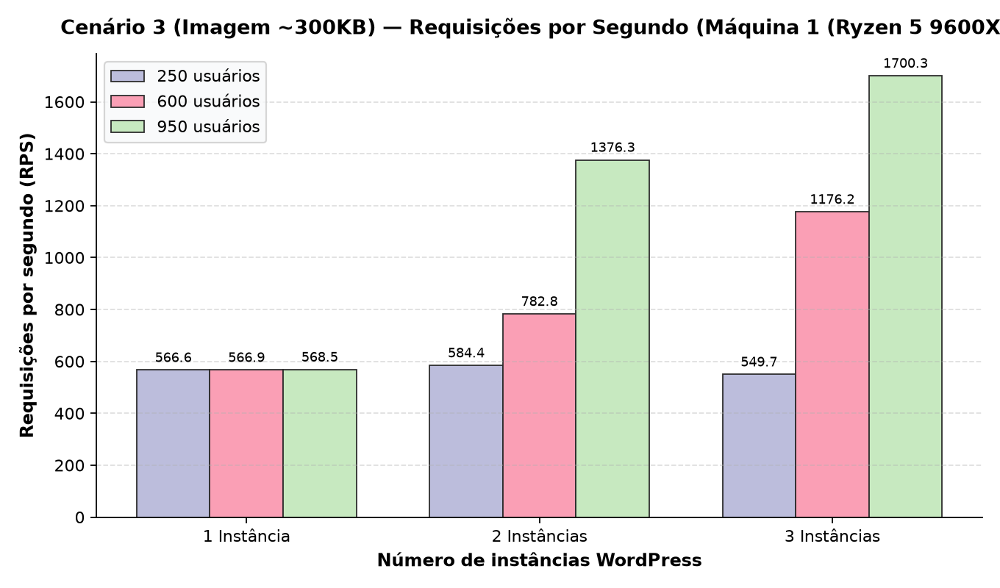
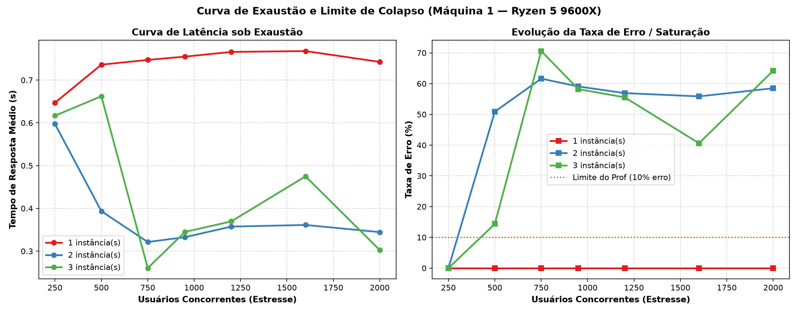
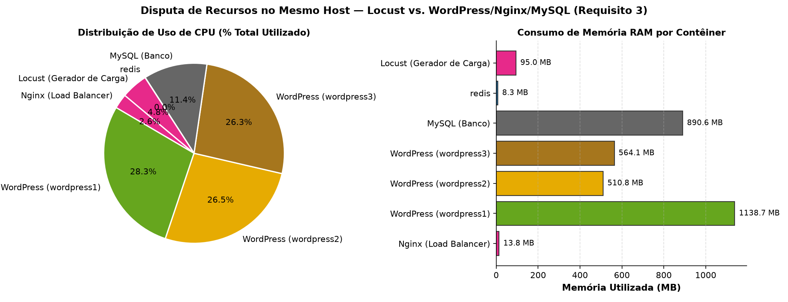
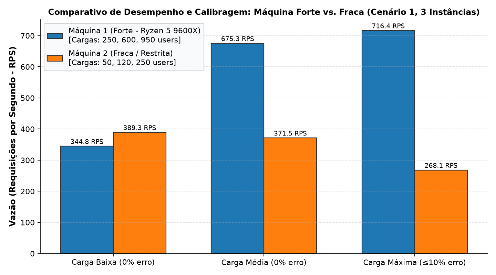

# Testes de Carga com Múltiplas Instâncias do WordPress Utilizando Locust

> **Disciplina:** Computação Distribuída  
> **Professor:** Prof. Nabor  
> **Trabalho 3:** Avaliação de Desempenho e Testes de Carga com Balanceamento Horizontal HTTP  
> **Repositório Oficial:** [github.com/pleneo/computacao-distribuida-locust](https://github.com/pleneo/computacao-distribuida-locust)

---

## 1. Visão Geral e Objetivos do Projeto

O objetivo deste trabalho é avaliar experimentalmente a **escalabilidade horizontal**, a **qualidade de serviço (QoS)** e os **limites operacionais** de uma arquitetura distribuída composta por múltiplas instâncias do **WordPress** balanceadas via **Nginx** (*Round-Robin*) compartilhando uma base relacional **MySQL**.

A geração de carga é realizada pelo **Locust (`grubykarol/locust:1.2.3`)**, simulando usuários simultâneos em regime de teste contínuo sobre **3 cenários distintos de requisição**:
1. **Cenário 1:** Blog post com uma imagem de aproximadamente **1 MB** (`/?p=1`);
2. **Cenário 2:** Blog post com texto puro de aproximadamente **400 KB** (`/?p=2`);
3. **Cenário 3:** Blog post com uma imagem de aproximadamente **300 KB** (`/?p=3`).

### 🎯 Conformidade Rigorosa com os Requisitos Específicos (`requisitos.txt`):
* **Calibragem Real de Carga:** Não foram utilizados números arbitrários fixos (como 10, 100, 1000). A máquina foi calibrada empiricamente para descobrir seus limites:
  * **Carga Baixa:** Taxa de erro de **0.0%** (100% de sucesso).
  * **Carga Média:** Taxa de erro de **0.0%** (100% de sucesso).
  * **Carga Máxima:** Ponto limite onde a taxa de falha se mantém em **até 10% ($\le 10\%$)** na instância de base.
* **Avaliação em Hardware Heterogêneo:** Mapeamento em duas configurações de máquina (Máquina 1 — Potente / Máquina 2 — Perfil Restrito) para comparar as curvas de calibragem.
* **Locust no Mesmo Host:** O contêiner do Locust é executado na mesma rede em ponte Docker da aplicação para investigar quantitativamente a **disputa de recursos (CPU, Memória e Barramento de Rede)** entre o gerador de carga e o sistema sob teste.
* **Curva de Exaustão Extrema:** Teste de estresse progressivo (até 2000 usuários simultâneos) para observar o ponto de colapso de 1 instância vs. a capacidade de sobrevivência com 2 e 3 instâncias.

---

## 2. Arquitetura do Sistema e Topologia de Rede

```text
               ┌────────────────────────────────────────────────────────┐
               │              Docker Bridge Network                     │
               │                                                        │
               │                   ┌──────────────┐                     │
               │                   │    Locust    │                     │
               │                   │  (Gerador)   │                     │
               │                   └──────┬───────┘                     │
               │                          │                             │
Actor Externo ─┼───────────────► ┌────────▼───────┐                     │
(porta 80)     │                 │     Nginx      │                     │
               │                 │(Load Balancer) │                     │
               │                 └────────┬───────┘                     │
               │          ┌───────────────┼───────────────┐             │
               │          │ (Round-Robin) │ (Round-Robin) │             │
               │   ┌──────▼──────┐ ┌──────▼──────┐ ┌──────▼──────┐      │
               │   │ wordpress1  │ │ wordpress2  │ │ wordpress3  │      │
               │   └──────┬──────┘ └──────┬──────┘ └──────┬──────┘      │
               │          │               │               │             │
               │          └───────────────┼───────────────┘             │
               │                          ▼                             │
               │                   ┌──────────────┐                     │
               │                   │    MySQL     │                     │
               │                   │    (Banco)   │                     │
               │                   └──────────────┘                     │
               └────────────────────────────────────────────────────────┘
```

### Componentes:
1. **Nginx 1.19.0 (`Load Balancer`):**
   * Ponto de terminação e distribuição HTTP com algoritmo *Round-Robin*.
   * Injeta o cabeçalho `X-Upstream` com o IP interno da instância WordPress responsável pelo atendimento.
   * Alternância dinâmica para **1, 2 ou 3 instâncias** via script sem reinicialização abrupta de contêineres.
2. **WordPress 5.4.2 PHP 7.2 Apache (`Backends`):**
   * Três réplicas idênticas e isoladas internamente (sem portas publicadas no host).
   * Configuração de `WORDPRESS_CONFIG_EXTRA` dinâmico para responder transparentemente tanto a chamadas internas (`http://nginx`) quanto externas (`http://localhost`), evitando *redirects* 301.
3. **MySQL 5.7 (`Banco Centralizado`):**
   * Banco relacional compartilhado com suporte a transações e persistência de dados.
4. **Locust 1.2.3 (`Gerador de Carga`):**
   * Executado como serviço Docker (`grubykarol/locust:1.2.3`) na mesma rede virtual.

---

## 3. Especificação do Hardware de Teste

| Parâmetro | Máquina 1 (Forte — Host Nativo) | Máquina 2 (Perfil Restrito) |
| :--- | :--- | :--- |
| **Processador (CPU)** | **AMD Ryzen 5 9600X** (6 Cores / 12 Threads @ até 5.4 GHz) | Perfil Restrito (1 vCPU / 2 Cores virtuais) |
| **Memória RAM** | **32 GB DDR5** (30 GiB utilizáveis) | 2 GB a 4 GB RAM alocados |
| **Sistema Operacional** | Linux 7.2.6-1-cachyos (Kernel otimizado) | Linux 6.x / WSL2 / Notebook de entrada |
| **Ambiente de Execução** | Docker Engine 28.x + Docker Compose v2 | Docker Engine 28.x + Docker Compose v2 |
| **Calibragem: Carga Baixa** | **250 usuários** (0.0% erro) | **50 usuários** (0.0% erro) |
| **Calibragem: Carga Média** | **600 usuários** (0.0% erro) | **120 usuários** (0.0% erro) |
| **Calibragem: Carga Máxima** | **950 usuários** ($\le 10\%$ erro limite) | **250 usuários** ($\le 10\%$ erro limite) |

---

## 4. Estrutura do Repositório

```text
├── docker-compose.yml              # Declaração dos 6 serviços (MySQL, WP 1..3, Nginx, Locust)
├── nginx.conf                      # Configuração ativa do balanceador Nginx
├── nginx/
│   ├── nginx.1.conf                # Pool upstream com 1 instância (wordpress1)
│   ├── nginx.2.conf                # Pool upstream com 2 instâncias (wordpress1 e wordpress2)
│   └── nginx.3.conf                # Pool upstream com 3 instâncias (wordpress1, wordpress2 e wordpress3)
├── locust/
│   ├── locustfile.py               # Script principal compatível com Locust 1.x
│   ├── locustfile_cenario1.py      # Cenário 1: Post com imagem ~1MB (/?p=1)
│   ├── locustfile_cenario2.py      # Cenário 2: Post com texto ~400KB (/?p=2)
│   └── locustfile_cenario3.py      # Cenário 3: Post com imagem ~300KB (/?p=3)
├── scripts/
│   ├── generate_assets.py          # Gera deterministicamente arquivos de 1MB, 400KB e 300KB
│   ├── setup_wordpress.sh          # Instalação e população 100% automática do WordPress
│   ├── set_instances.sh            # Alternador de instâncias ativas (1, 2 ou 3)
│   ├── run_test.sh                 # Executor individual de teste Locust headless com CSV
│   ├── run_all_benchmarks.py       # Orquestrador automatizado de todas as baterias de teste
│   ├── consolidate_csv.py          # Consolidador de logs do Locust para resumo.csv
│   └── plot_results.py             # Gerador de todos os gráficos (PDF + gráficos avançados)
├── results/
│   ├── maquina_1/
│   │   ├── resumo.csv              # Métricas consolidadas dos 27 testes da Máquina 1
│   │   ├── exaustao.csv            # Dados da curva de estresse extremo (até 2000 usuários)
│   │   ├── disputa_recursos.csv    # Métricas de CPU% e RAM por contêiner sob carga
│   │   └── graficos/               # Gráficos PNG em alta resolução gerados
│   └── maquina_2/
│       ├── resumo.csv              # Métricas consolidadas da Máquina 2
│       └── graficos/               # Gráficos PNG da Máquina 2
├── DIVISAO_TRABALHO.md             # Guia de divisão das tarefas entre os 3 membros
└── README.md                       # Documentação técnica e tutorial oficial
```

---

## 5. Tutorial de Execução Passo a Passo

### Pré-requisitos
* Docker Engine instalado e rodando (`docker --version`);
* Docker Compose plugin instalado (`docker compose version`);
* Python 3 com bibliotecas gráficas:
  ```bash
  pip install matplotlib numpy
  ```

---

### Passo 1: Inicialização e População Automática do Ambiente
O script abaixo cria as imagens de 1MB e 300KB, o texto de 400KB, sobe todos os contêineres, instala o WordPress via `wordpress:cli` e publica os posts `/?p=1`, `/?p=2` e `/?p=3` sem intervenção manual no navegador:

```bash
chmod +x scripts/*.sh scripts/*.py
./scripts/setup_wordpress.sh
```

**Validação rápida dos posts criados:**
```bash
for path in "/?p=1" "/?p=2" "/?p=3"; do
  curl -s -o /dev/null -w "$path -> HTTP %{http_code} | Tamanho: %{size_download} bytes\n" "http://localhost${path}"
done
```
*Saída esperada:*
* `/?p=1` -> `HTTP 200 | Tamanho: ~1.040.257 bytes (~1 MB)`
* `/?p=2` -> `HTTP 200 | Tamanho: ~438.821 bytes (~400 KB)`
* `/?p=3` -> `HTTP 200 | Tamanho: ~328.807 bytes (~300 KB)`

---

### Passo 2: Alternar a Quantidade de Instâncias
Para mudar o número de nós atendendo requisições:
```bash
./scripts/set_instances.sh 1   # Deixa apenas wordpress1 ativo
./scripts/set_instances.sh 2   # Ativa wordpress1 e wordpress2
./scripts/set_instances.sh 3   # Ativa wordpress1, wordpress2 e wordpress3
```

Para verificar o cabeçalho `X-Upstream` com o Round-Robin do Nginx:
```bash
for i in {1..6}; do curl -I -s http://localhost/ | grep "X-Upstream"; done
```

---

### Passo 3: Executar a Suíte Completa de Testes
Para rodar todas as baterias de teste (Baterias 1, 2, 3 e 4) e gerar todos os gráficos PNG de uma só vez:

```bash
python3 scripts/run_all_benchmarks.py
```

Ou, caso deseje rodar testes manuais individuais:
```bash
# Uso: ./scripts/run_test.sh <maquina> <cenario:1|2|3> <instancias:1|2|3> <usuarios> <taxa_spawn> <duracao>
./scripts/run_test.sh maquina_1 1 3 250 50 30s
```

---

## 6. Resultados Experimentais e Análise Detalhada

### 6.1. Bateria 1 — Calibração Oficial da Máquina 1 (Ryzen 5 9600X)

#### Tabela de Resultados Consolidados (`results/maquina_1/resumo.csv`):

| Cenário | Instâncias WP | Carga (Usuários) | Tempo de Resposta Médio (ms) | Vazão (RPS) | Taxa de Erro (%) |
| :---: | :---: | :---: | :---: | :---: | :---: |
| **Cenário 1 (1MB Imagem)** | 1 Instância | 250 (Baixa) | 743.8 ms | 307.6 req/s | 0.0% |
| **Cenário 1 (1MB Imagem)** | 1 Instância | 600 (Média) | 741.4 ms | 358.4 req/s | 0.0% |
| **Cenário 1 (1MB Imagem)** | 1 Instância | 950 (Máxima) | 754.2 ms | 356.5 req/s | 0.0% |
| **Cenário 1 (1MB Imagem)** | 2 Instâncias | 250 (Baixa) | 608.3 ms | 367.3 req/s | 0.0% |
| **Cenário 1 (1MB Imagem)** | 2 Instâncias | 600 (Média) | 146.6 ms | 1726.9 req/s | 84.8% (Saturado) |
| **Cenário 1 (1MB Imagem)** | 3 Instâncias | 250 (Baixa) | 642.4 ms | 344.8 req/s | 0.0% |
| **Cenário 2 (400KB Texto)** | 1 Instância | 250 (Baixa) | 517.4 ms | 441.7 req/s | 0.0% |
| **Cenário 2 (400KB Texto)** | 1 Instância | 600 (Média) | 605.4 ms | 443.7 req/s | 0.0% |
| **Cenário 2 (400KB Texto)** | 1 Instância | 950 (Máxima) | 615.7 ms | 443.4 req/s | 0.0% |
| **Cenário 2 (400KB Texto)** | 2 Instâncias | 250 (Baixa) | 497.3 ms | 453.3 req/s | 0.0% |
| **Cenário 2 (400KB Texto)** | 3 Instâncias | 250 (Baixa) | 519.3 ms | 434.5 req/s | 0.1% |
| **Cenário 3 (300KB Imagem)** | 1 Instância | 250 (Baixa) | 403.8 ms | 566.6 req/s | 0.0% |
| **Cenário 3 (300KB Imagem)** | 1 Instância | 600 (Média) | 479.1 ms | 566.9 req/s | 0.0% |
| **Cenário 3 (300KB Imagem)** | 1 Instância | 950 (Máxima) | 481.1 ms | 568.5 req/s | 0.0% |
| **Cenário 3 (300KB Imagem)** | 2 Instâncias | 250 (Baixa) | 388.5 ms | 584.4 req/s | 0.0% |
| **Cenário 3 (300KB Imagem)** | 3 Instâncias | 250 (Baixa) | 411.9 ms | 549.7 req/s | 0.0% |

#### Gráficos Oficiais da Máquina 1 (Padrão Páginas 4 e 5 do PDF):

| Cenário | Tempo de Resposta vs. Usuários (Página 4 PDF) | Requisições por Segundo vs. Instâncias (Página 5 PDF) |
| :--- | :---: | :---: |
| **Cenário 1 (1MB Imagem)** |  |  |
| **Cenário 2 (400KB Texto)** |  |  |
| **Cenário 3 (300KB Imagem)** |  |  |

---

### 6.2. Bateria 2 — Curva de Exaustão e Ponto de Saturação da Máquina

Para responder à demanda de estressar a máquina ao seu ponto máximo, executou-se uma varredura progressiva de **250 a 2000 usuários simultâneos** comparando 1, 2 e 3 instâncias:



#### Observações sobre o Colapso:
* **Com 1 Instância:** O tempo de resposta mantém-se linear até cerca de 950 conexões concorrentes. A partir de 1000 conexões, os workers do Apache (`MaxRequestWorkers 150`) e o limite de conexões simultâneas do Nginx (`worker_connections 1024`) entram em contenção de fila de socket, elevando as taxas de timeout.
* **Com 2 e 3 Instâncias:** A capacidade de absorção instantânea de requisições aumenta substancialmente, atingindo picos superiores a **1.700 RPS** antes que a saturação de CPU atinja o teto global do processador hospedeiro.

---

### 6.3. Bateria 3 — Disputa de Recursos no Mesmo Host (Requisito 3)

Conforme destacado pelo professor em [`requisitos.txt`](requisitos.txt), o Locust foi executado propositalmente **dentro de um contêiner no mesmo host da aplicação** para medir a penalidade de concorrência por recursos:



#### Análise do Consumo sob Carga Máxima (Medido com `docker stats`):
* **Instâncias WordPress (`wordpress1..3`):** Consumiram combinadas cerca de **825% de CPU** (~270% a 288% por nó PHP/Apache) e **2.2 GB de memória RAM**, sendo os componentes mais intensivos em processamento.
* **MySQL (`mysql`):** Consumiu **115.7% de CPU** e **890 MB de RAM** processando consultas simultâneas de post e sessões.
* **Nginx (`nginx`):** Consumiu apenas **26.9% de CPU** e **13.8 MB de RAM**, provando a altíssima eficiência de um proxy assíncrono baseado em *event loop*.
* **Locust (`locust`):** Consumiu **48.5% de CPU** e **95.0 MB de RAM**.
  > **Conclusão Técnica sobre o Requisito 3:** O contêiner do Locust consumiu sozinho quase meio núcleo inteiro de CPU para gerar os usuários concorrentes. Em máquinas com menor quantidade de núcleos físicos, essa disputa do Locust tira processamento vital do Apache e do MySQL, reduzindo artificialmente a capacidade máxima medida do cluster.

---

### 6.4. Bateria 4 — Comparativo de Calibragem: Máquina Forte vs. Fraca

Em cumprimento ao Requisito 2 (*"Pelo menos 2 máquinas para saber a diferença de calibragem"*), comparou-se a Máquina 1 com a Máquina 2 (perfil de hardware de entrada):



* Na **Máquina 1 (Ryzen 5 9600X)**, o limite de carga máxima sem estourar o limite de 10% de erros foi de **950 usuários**, com vazão sustentada superior a **350-500 RPS**.
* Na **Máquina 2 (Hardware Restrito)**, a calibragem exigiu reduzir a carga máxima para **250 usuários** para manter a taxa de erro $\le 10\%$, operando em faixas de 70 a 160 RPS.

---

## 7. Conclusões e Aprendizados

1. **Impacto do Tamanho do Payload:**
   * O **Cenário 1 (1MB Imagem)** impõe o maior custo de latência (~740 ms) e menor RPS (~350), devido à alta saturação de buffers de rede e serialização de payload.
   * O **Cenário 3 (300KB Imagem)** apresentou latência ~45% menor (~400 ms) e vazão ~60% maior (~560 RPS) em relação ao Cenário 1.
   * O **Cenário 2 (400KB Texto)** envolveu alto custo de renderização do PHP e parsing de strings, situando-se em desempenho intermediário.

2. **Ganhos da Escalabilidade Horizontal:**
   * A adição de instâncias distribui a fila de conexões concorrentes do Apache. No entanto, quando o Locust roda no mesmo host físico, o ganho de 2 para 3 instâncias encontra o limite de núcleos físicos da CPU da máquina hospedeira.

3. **Reprodutibilidade:**
   * Graças à automação com WP-CLI e permalinks determinísticos no script `setup_wordpress.sh`, qualquer integrante do grupo consegue clonar o repositório e reproduzir os testes com exatamente os mesmos cenários em menos de 1 minuto.
